# 背景

该Repo是对本人*学习API*、*API数据拉取和整理实战*以及*反思与总结*的实战记录。

虽然之前学过API的基本理论知识和简单上手操作，详见 [APIs_Learning.ipynb](APIs_Learning.ipynb) ，**但正儿八经拉取并整理API数据、应用到实际项目这算是头一回**。

本次API尝试数据获取是在Canvas这一学习管理系统中开展，目的是为推进某项教育研究的数据分析。该教育研究是为了**分析Peer review活动对学生某高阶思维的影响**，因此**需要Peer review活动与学生高阶思维等相关数据**。 

该Canvas API实战主要参考Canvas官方的API文档并在ChatGPT协助下落地，总共分为几个阶段：

## 初始工作流（已反思）

1. 在Postman中利用 **GET 以及相关命令行** 开展初始数据获取测试，对应到Canvas实际课程的学生作业与其成绩数据**查看返回结果是否准确**。 

   **反思**：后续这一步被我删除，尤其是在时间紧的情况下，没必要**在数据是否符合需求的判断之前**就核对返回数据是否准确。 
   
   这一步的核对可以在下面第 2 步中直接开展，**在获得想要数据类型和结果的基础上再去核对数据是否准确更高效**。

   （但我是第一次现实中的实战，所以对API返回后的结果尤其想要看看是否准确。）

2. 在上述结果准确后，查看数据类型和结果是否符合该教育研究数据的需求。 

    在多次返回结果中均未发现`"assessment_type": "peer_review"`的数据结果，而是默认为`"assessment_type": "grading"`的大量数据。本次教育研究需要的数据包括Peer review和grading的数据，因此多次尝试不同的API需求命令。 

    **反思**：快速搜索返回数据中**是否包含关键字段**，判断是否符合研究数据的需求。这里的关键字段即`"assessment_type": "peer_review"`。

3. 多次尝试后，终于返回的数据既包含 Peer review 又包含 grading 的数据。但需要利用 Python 脚本将这些数据整理成最终的长数据类型，可能长下面这样： 

   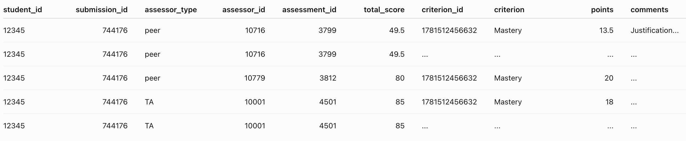

    这部分的脚本代码我让ChatGPT先写了草稿，接着就尝试在 [CanvasAPI_Coding.ipynb](CanvasAPI_Coding.ipynb) 中测试和查看结果，根据自身需求调试代码。

Last updated: 2026-10-6 

## 代码调试与调整反思

### 1. `.env` 环境变量的文件要单独创建

作为一个初级小白，我连 `.env` 这样的环境变量文件需要单独创建来放置 API 请求地址和 Access Token 都不知道。

于是一开始，我根据 AI 的代码（但当时没看懂`.env`的配置），直接在 Python 中创建了 2 个字符串变量，专门定义了 API 需求的主要地址和 Access Token。

**反思**：其实这非常危险⚠️ 这样的密钥暴露在代码中，一旦代码被Git到云端且公开访问，那所有人都将拥有该 API 地址的数据访问权限。

### 2. 创建`.gitignore`可以避免同步环境变量文件
    
ChatGPT提醒我，在Jupiter Notebook文件所在的文件夹中创建 `.gitignore` 文件并写明其中的`.env`可以避免在git代码到云端时，暴露密钥信息。

我自己尝试了一下，果然在 Git Push 之后，`.env` 中的环境变量没有被同步到云端。这一点，必须夸夸AI，因为它能主动补足我没有经验或不懂的领域。

### 3. 调试代码

#### 3.1 理解代码功能逻辑 + 多次测试

ChatGPT 给的大部分代码都是可以直接成功运行的，但我在运行后看到结果会倒推程序实现的功能，然后和AI聊聊自己的理解是否正确。AI会给出及时的反馈，纠正我不正确的理解并给出具体的例子。

我甚至还从AI那里知道了 *Http 状态码 `200` = 请求成功*。之前虽然浅显地学习了API请求方式，但其实对 Http 的协议不是特别熟悉（曾经也学过计算机网络和TCP/IP，但实在已经忘完了）。

有时候程序运行会报错，于是把报错信息直接贴给AI。AI则会直接开始详细分析，并且给出测试问题的方案。我是个懒鬼，不想从头来写代码，通常会让AI告诉我最少工作量的简洁修改方式。比如下图： 

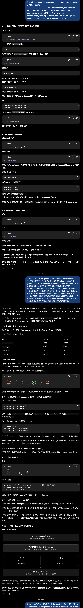

#### 3.2 看到 DataFrame(df) 的默认语法局限性

此外，当代码测试完成、结果输出后，有时候具有迷惑性。比如，Python通常会直接以 head() 命令输出 df 的前 6 行，但当 df 长度较长时，就无法看到输出数据的全貌。

我当时看到不完整的数据和大量   `NaN` 的出现，产生了一种前面写的代码有问题、没有把数据整理完成的错觉。后来想要更清晰地看到 df 的全貌，于是也是开始问豆包 df 的前 N 行怎么输出：

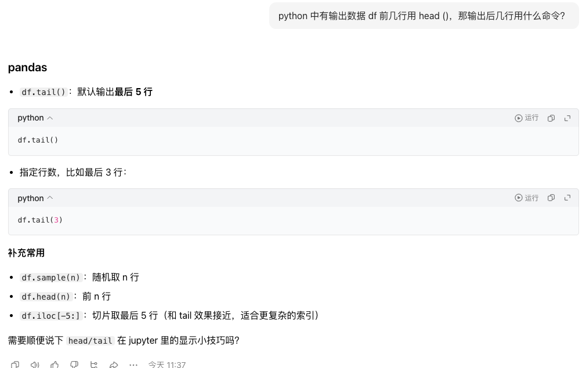 

以及，df 的后 M 行后 N 列怎么输出：

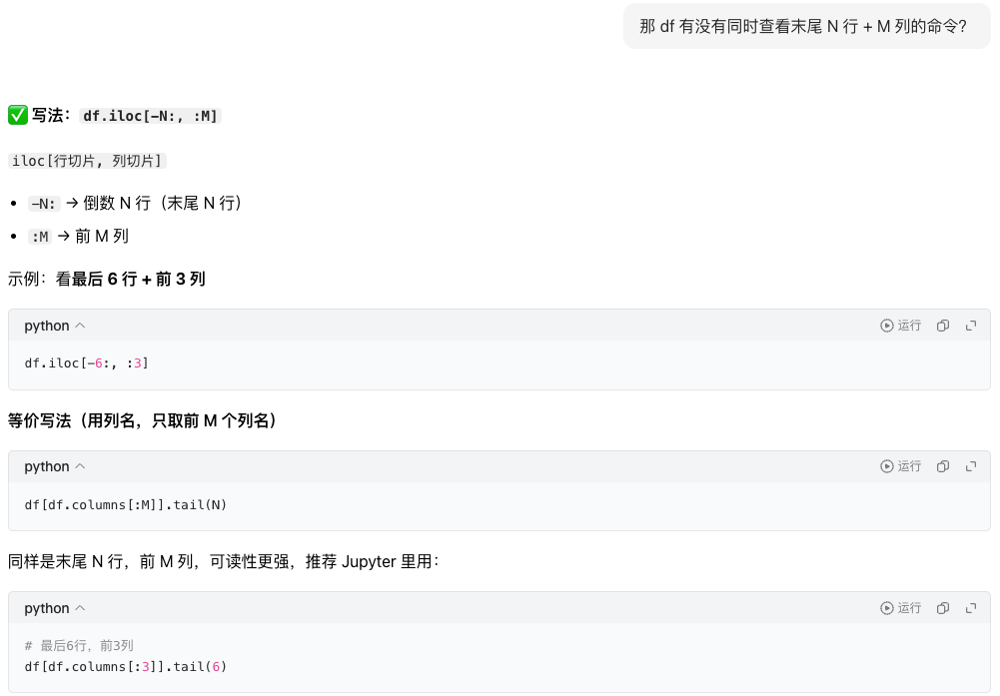 

这些语法的效果非常好，让我看到了已生成 df 的全貌，没有误判前面代码有错误。毕竟，长长的函数如果要排查其中数据获取错误的细节，估计也要费一番功夫。

#### 3.3 AI可能也会犯糊涂

前期其实我就和ChatGPT说过了，我是从某一个API 需求地址中直接拉回了所有 Peer review 和 TA grading的数据。也就是说，如果Peer review数据从某个地址已经实现数据整理，那相应地这个地址里也可以取出TA grading的数据来整理。但实际上 TA grading的数据持续没有结果： 

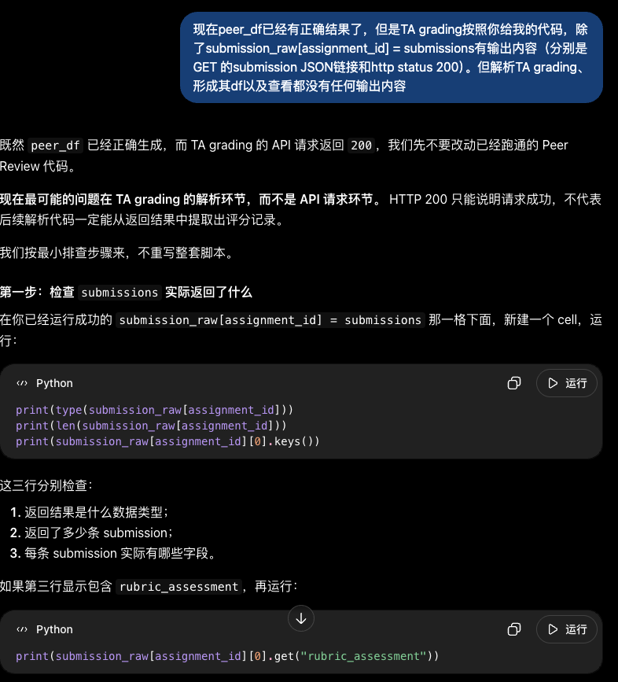 

我依据 AI 反馈测试后发现输出内容并不和AI 预测的吻合，开始怀疑这里 TA grading拉取数据的地址不对。和AI 聊时，它又开始胡说：

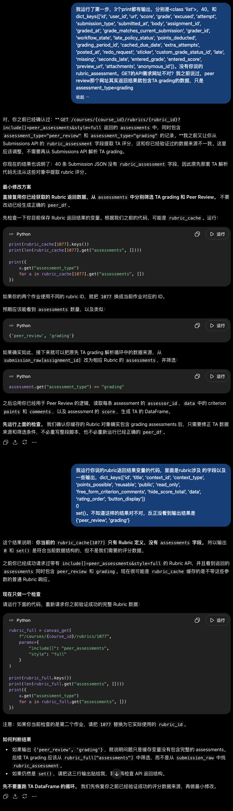 

但我在Jupiter Notebook中的测试结果依然不对。于是我开始找上面 Peer review数据获取成功的API需求地址。发现用于Peer review的API需求对参数的核心定义是这样的：

```Python
data = canvas_get(
f"/courses/{course_id}/rubrics/{rubric_id}",
params={
    "include[]": "peer_assessments",
    "style": "full"
}
```

但实际上，我在Postman中测试API返回完整的数据时，用的API需求地址是https://hkust-gz.instructure.com/api/v1/courses/3308/rubrics/1077?include[]=assessments&style=full。

显然，其中`include[]`参数定义不匹配。因此，AI一开始给出的全套代码前后的API需求地址没有按照我的要求用统一的前述地址。那明天的任务就是利用这个地址去提取 TA grading的数据并整理好。

Last updated: 2026-10-9

## TA grading跑完后的数据对比大乌龙

### 1. TA grading数据获取

基于昨天发现的API需求链接出错，今天更换了新的链接后，数据获取成功了。也是让ChatGPT生成脚本的草稿版本，然后一步步在[CanvasAPI_Coding.ipynb](./CanvasAPI_Coding.ipynb)中调试、查看和核对结果。

### 2. 误核对Peer review和TA grading的结果

这里其实是我自己的问题，我误以为Canvas课程中web链接的`student id`是唯一改变学生作业评分结果页面的参数。如下图：

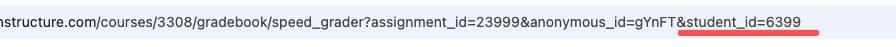

想要就此简单改变学生id后直接查看该生作业评分结果并与代码跑出来的结果核对。但这项作业的peer review是**匿名**的，如果我需要切换到其他学生，必须也同时修改前面的`anonymous_id`，否则Canvas课程页面呈现出来的结果肯定和代码结果对不上。

最初我没意识到这一点😂😂😂就担心这么多cell的代码跑出的数据和原课程对不上，修改的工作量得多大。就和AI吐槽了这个事情：

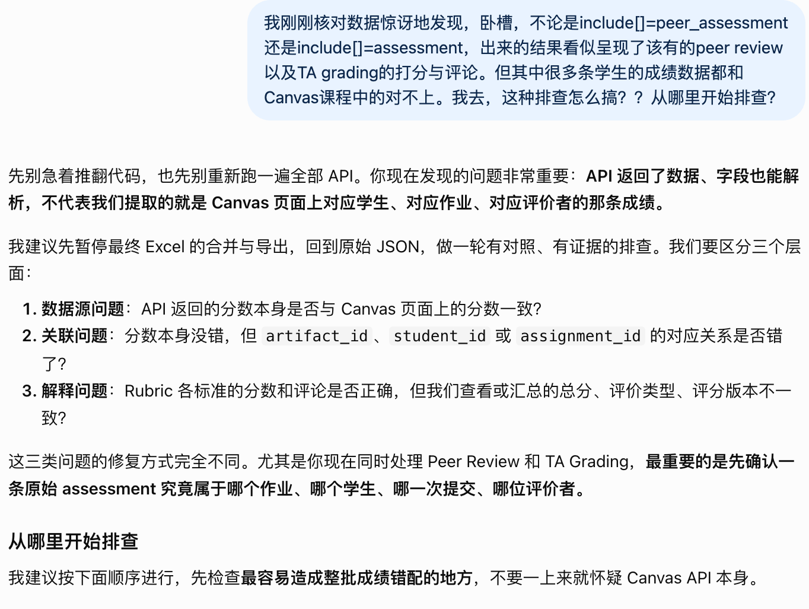

虽然AI一下子就给出了代码，但我更想现在Postman中查验数据反馈的原始情况。于是开始和AI询问JSON中字段的含义，并反复比对Canvas原课程和Postman中的数据：

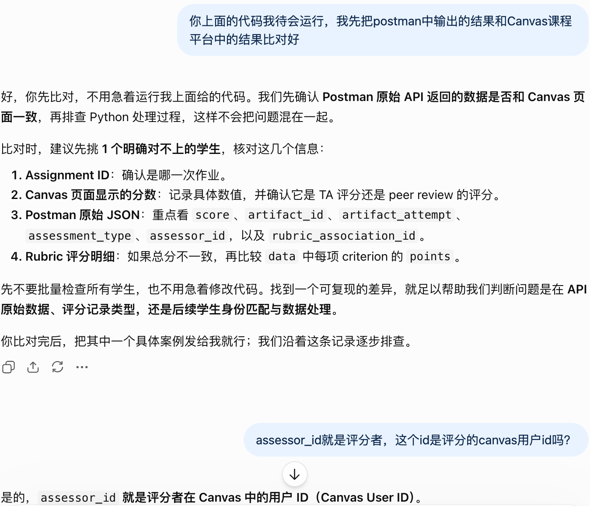

### 3. 核对数据的正确过程很重要

由于上述`anonymous_id`根据不同学生是变化的，因而我需要通过**Canvas系统网页的界面UI**来切换到不同学生的作业评分页面查看实际数据详情。

同时，利用已经生成的数据结果中`assessor_id`在Canvas系统中找到参与评价的student reviewer，并对应到前述课程评价页面中核对姓名、评分结果是否能与目前通过API获取到的数据结果能匹配上。

于是，这一波核对完，我终于能确认，这些peer review和TA grading的数据和原课程中的数据都能对应上了，其实通过API代码输出的数据结果是正确的！终于啊🥳🥳🥳

Last updated: 2026-10-10

## TA grading中 Comment for this attempt 获取

上述将TA grading的数据拉取成功、整理到位后，还涉及拉取TA留在学生作业批改页面的Comment文本。TA没有像学生reviewer那样利用rubrics去留存comment，而是直接利用Canvas Speedgrader页面中的`Comment for this attempt`来产生总体的质性评估。

为了获取`Comment for this attempt`的确切数据，我开始和ChatGPT聊怎样定位到合适的API地址。但这个过程出现了一些小挫折——并没有我想象中那么简单就能找到合适的地址。

### 1. 获取数据API地址

我一开始自己查询 [Submission Comments的Canvas API 文档](https://developerdocs.instructure.com/services/canvas/resources/submission_comments)，利用关键词 *comment* 来快速检索相关的API地址。（后续找错地址说明这个思路不对）其中和comment有关的API需求命令是这样的：

```
/api/v1/courses/:course_id/assignments/:assignment_id/submissions/:user_id/comments/:id
```

但是尝试即便不加最后的id，也很难在Postman中看到comments的内容，于是我意识到请求的地址不对。于是开始问AI，AI开始分析我的API需求。

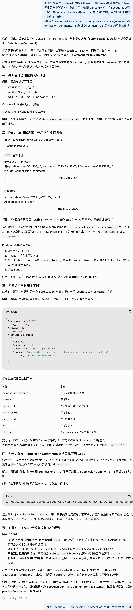

它给了一些提示，让我先明确真正的API地址去获得学生作业提交和评论信息。并告诉我，submission comment的API文档其实更针对某次作业提交的评论（submission comment），而不是TA在Canvas的Speedgrader页面中，对学生某次作业提交留下的Comment for this attempt。

于是，我开始使用以下命令尝试拉取某位学生的相关数据：

```
GET /api/v1/courses/COURSE_ID/assignments/ASSIGNMENT_ID/submissions/STUDENT_ID?include[]=submission_comments&include[]=submission_history
```

但这次尝试，Postman中返回的数据中也搜不到submission_comment这个字段，也就是说API的请求地址仍然不对。

在和AI说明情况后，它开始减少API请求地址末尾的参数让我尝试下列地址：

```
GET https://你的Canvas域名/api/v1/courses/COURSE_ID/assignments/ASSIGNMENT_ID/submissions/STUDENT_ID
```

虽然这个地址能抓回一些数据，但这些数据中依然没有submission_comment这个关键字段。于是，AI再次修改了API地址后续的参数：

```
https://hkust-gz.instructure.com/api/v1/courses/3308/assignments/23999/submissions/6470?include[]=submission_comments
```

这次，就有了submission_comment的关键字段！

### 2. API地址寻找的反思

我很疑惑，为什么自己找到的地址不对，而AI却能在几次尝试后找到合适的地址。那以后又该如何高效找准类似的地址呢？结合AI的回应，我有以下反思：

#### 2.1 厘清需求

我要找的数据其实是**submission资源中相关联的comment数据**，而不是comment资源的直接接口。前者是**在作业提交记录中读取评论**，后者是**对某个评论执行具体操作**。

Submission comments是把评论当作独立资源，其API地址中参数**要求明确comment的具体ID**，方便我对某个评论执行具体操作。其地址是：

```
/api/v1/courses/:course_id/assignments/:assignment_id/submissions/:user_id/comments/:id
```

正如AI所说，这样的链接表达的层级是：

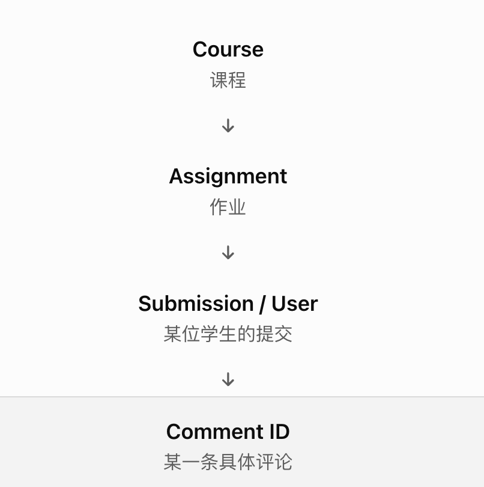

而这意味着这个地址假设我这个用户（数据获取者）**是已经知道某条评论的id**。而这并不符合我**想要读取某些提交作业相关联评论**（我是**未知评论id**的状态）的需求。因此，这个API的地址其实不匹配我的需求，用它的地址我拿不到自己想要的数据。

但如果把Comment for this attempt当作提交记录的关联数据来读取，就意味着定位到某个作业并明确要获取数据的的具体参数即可，即：

```
GET /api/v1/courses/3308/assignments/23999/submissions/6470?include[]=submission_comments
```

可以说，上述2种数据对应的需求和资源具有以下关系：

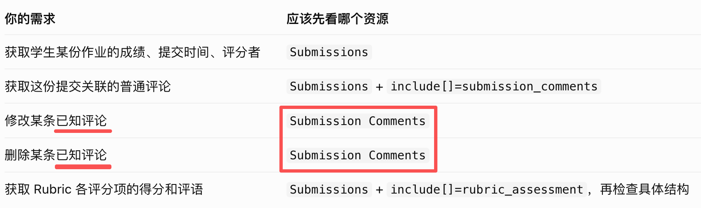

#### 2.2 以后找API地址的有效策略

**第 1 步：明确目标数据是什么**

先问自己：我要获取的是一条 Submission、一个 Comment、一个 Rubric Assessment，还是某个学生的 User 信息？

例如，你要的是“学生某次作业提交上的普通评论”，所以主资源是 Submission，评论是它关联的数据。

**第 2 步：先找 GET，而不是只搜资源名称**

在资源页面中优先找 Get a single...、List...、Show 等读取接口。

你可以直接在官方文档中使用浏览器的 Ctrl + F（Mac 为 Command + F）搜索 GET、include[]、submission_comments。

**第 3 步：检查参数与返回字段**

找到 GET 地址后，继续检查： 

- Request Parameters：是否支持 include[]？
- Allowed values：是否有你需要的关联对象？
- API response 或对象定义：返回字段叫什么？
这一步能避免把“接口可以操作评论”误认为“接口可以直接读取评论列表”。

**第 4 步：用一条真实记录验证**

用一位已知有评论的学生进行 Postman 测试，对照 SpeedGrader 中的内容，检查返回字段、作者、时间和评论正文是否吻合。

只有实际返回的数据与目标一致，才算真正找到正确的接口。

**其他技巧**

1. 先找对应的资源，再找关联字段

先根据需求找到对应资源的返回数据，再阅读API文档根据请求参数include[]加载/细化关联数据。例如：

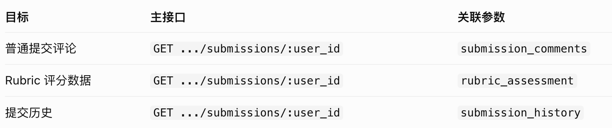

2. 找到资源后，要看是否有对应的http方法

同一个资源对应不同的操作，比如GET、POST、PUT、DELETE等。当API链接中有/comments/:id 时，**不要立即认定它支持 GET**。要继续看该路径下面**实际列出了哪些 HTTP 方法**，方法如果对不上则也说明这个API链接不能实现需求。

3. 不需要读完所有API文档，先确定需求最相关的正确资源对象

Last updated: 2026-10-20


## 参考文档：

Canvas API相关文档：

https://developerdocs.instructure.com/services/canvas/resources/rubrics 

https://developerdocs.instructure.com/services/canvas/resources/submissions 

https://developerdocs.instructure.com/services/dap/dataset/dataset-namespaces/dataset-canvas?utm_source=chatgpt.com 


